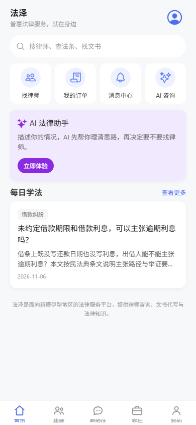
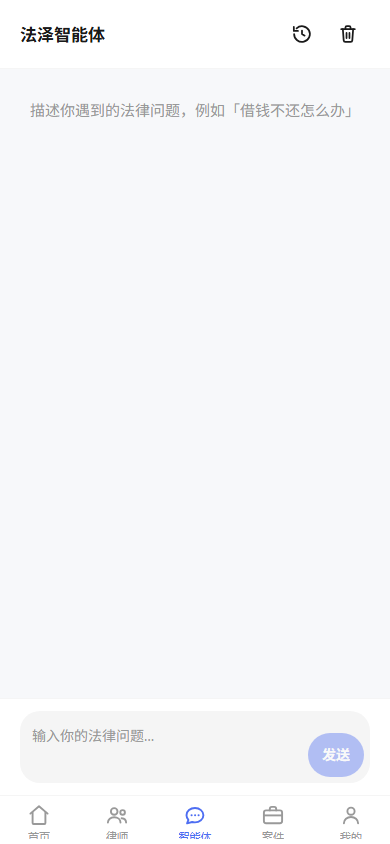
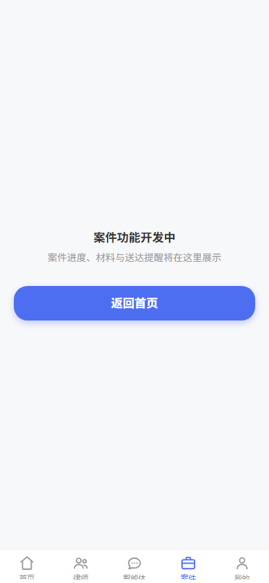

# 第 3 段 · F1「`(tabs)` 补建 + tab3 路由」验收证据

> 施工日期：2026-11-07 · 分支 `UI设计` · 施工成员：`fe-ai`
> 对应工作流：`docs/architecture/法泽FAZE_第3段工作流_v1.0.md` L1040–1073（F1）、导航树附录 L705–711
> 环境：Windows / PowerShell 5.1 / Node v24.16.0 / Expo SDK 54（`expo-router ~6.0.24`、`@react-navigation/bottom-tabs 7.21.0`）
> 结论：**五个 tab 壳、`(tabs)` 分组、tab3 接 F2 页、tab4 占位页、五套 `testID` 都已落地；
> `npm run verify` 全绿；web 产物导出成功（路由树可打包）。真机/模拟器截图与 RTL 镜像目测无法在本机执行，
> 按批次约定挂账给 Lead 用 CDP/模拟器复核。**

---

## 一、交付物

| 文件 | 状态 | 说明 |
|---|---|---|
| `apps/mobile-app/app/(tabs)/_layout.tsx` | 新建 | 五 tab 布局（`Tabs`），选中色/字号/图标统一 |
| `apps/mobile-app/app/(tabs)/home.tsx` | **移动**自 `app/home.tsx` | 路由壳，一行导出 `HomePage`，URL 仍 `/home` |
| `apps/mobile-app/app/(tabs)/profile.tsx` | **移动**自 `app/profile.tsx` | 路由壳，一行导出 `MyPage`，URL 仍 `/profile` |
| `apps/mobile-app/app/(tabs)/lawyer.tsx` | 新建 | 指向既有 `LawyerListPage`（**未改** `routes.ts`、**未删** `app/lawyer-list.tsx`） |
| `apps/mobile-app/app/(tabs)/agent.tsx` | 新建 | 指向 F2 的 `AiChatPage`（`/agent`） |
| `apps/mobile-app/app/(tabs)/case.tsx` | 新建 | 指向 `CasePlaceholderPage`（`/case`） |
| `apps/mobile-app/features/case/pages/CasePlaceholderPage.tsx` | 新建 | 占位空态：居中文本 +「返回首页」，**无假列表** |
| `apps/mobile-app/shared/components/icons/TabIcons.tsx` | 新建 | 5 个 24dp 线性 SVG 图标（`react-native-svg` 重画设计稿内联 SVG） |
| `apps/mobile-app/shared/i18n/resources/zh-Hans/common.json` | 修改 | 加 `common.tab.{home,lawyer,agent,case,profile}` 5 个 key |
| `apps/mobile-app/shared/i18n/resources/zh-Hans/case.json` | 修改 | 加 `case.placeholder.{title,hint,backHome}` 3 个 key |
| `apps/mobile-app/shared/i18n/resources/.i18n-pending.json` | 修改 | 脚本生成：三语言各 +21 条（F1 的 8 条 + F2 的 13 条） |
| `apps/mobile-app/package.json` / `package-lock.json` | 修改 | 见第四节依赖 |

---

## 二、路由改造：**移动**而不是新建（避免重复路由）

`(tabs)` 是 expo-router 的 route group，**不占 URL 段**：`app/(tabs)/home.tsx` 与 `app/home.tsx`
都映射 `/home`，同时存在会冲突。因此首页/我的页是**移动**，URL 与 `routes.ts` 的
`'/home'` `'/profile'` 都不变。

真实输出：

```text
$ git status --porcelain apps/mobile-app
 D apps/mobile-app/app/home.tsx
 D apps/mobile-app/app/profile.tsx
 M apps/mobile-app/package-lock.json
 M apps/mobile-app/package.json
 M apps/mobile-app/shared/components/AiGeneratedLabel.tsx
 M apps/mobile-app/shared/i18n/resources/.i18n-pending.json
 M apps/mobile-app/shared/i18n/resources/zh-Hans/ai.json
 M apps/mobile-app/shared/i18n/resources/zh-Hans/case.json
 M apps/mobile-app/shared/i18n/resources/zh-Hans/common.json
?? apps/mobile-app/app/(tabs)/
?? apps/mobile-app/features/ai/
?? apps/mobile-app/features/case/
?? apps/mobile-app/shared/components/MessageBubble.tsx
?? apps/mobile-app/shared/components/icons/AiIcons.tsx
?? apps/mobile-app/shared/components/icons/TabIcons.tsx
（另有 docs/acceptance/seg3/E1-label.md 与依赖清单的修改，见交付报告）

$ Test-Path apps\mobile-app\app\home.tsx        → False
$ Test-Path apps\mobile-app\app\profile.tsx     → False
$ Get-ChildItem 'apps\mobile-app\app\(tabs)' -File → agent.tsx case.tsx home.tsx lawyer.tsx profile.tsx _layout.tsx
```

**律师 tab 的两条入口并存**：`app/(tabs)/lawyer.tsx`（新，`/lawyer`）+ `app/lawyer-list.tsx`（旧，`/lawyer-list`，
段 2 入口，不动）。`shared/navigation/routes.ts` 未改（`git status` 里没有它）。

---

## 三、五 tab 配置与 `testID`

`app/(tabs)/_layout.tsx` 真实行号（`Select-String` 输出节选）：

```text
LineNumber Line
--------- ----
        48         tabBarActiveTintColor: color.brand.primary,
        49         tabBarInactiveTintColor: color.text.muted,
        63           title: t('common.tab.home'),
        64           tabBarButtonTestID: 'tab-home',
        65           tabBarIcon: ({ color: tint }) => <TabHomeIcon color={tint} />,
        71           title: t('common.tab.lawyer'),
        72           tabBarButtonTestID: 'tab-lawyer',
        79           title: t('common.tab.agent'),
        80           tabBarButtonTestID: 'tab-agent',
        87           title: t('common.tab.case'),
        88           tabBarButtonTestID: 'tab-case',
        95           title: t('common.tab.profile'),
        96           tabBarButtonTestID: 'tab-profile',
```

| 序号 | tab | 路由 | 页面实现 | `title` key | `testID` | 图标 |
|---|---|---|---|---|---|---|
| 1 | 首页 | `/home` | `features/home/pages/HomePage.tsx`（段 2，未改） | `common.tab.home` | `tab-home` | `TabHomeIcon` |
| 2 | 律师 | `/lawyer` | `features/lawyer/pages/LawyerListPage.tsx`（段 2，未改） | `common.tab.lawyer` | `tab-lawyer` | `TabLawyerIcon` |
| 3 | 智能体 | `/agent` | `features/ai/pages/AiChatPage.tsx`（本批 F2） | `common.tab.agent` | `tab-agent` | `TabAgentIcon` |
| 4 | 案件 | `/case` | `features/case/pages/CasePlaceholderPage.tsx`（占位） | `common.tab.case` | `tab-case` | `TabCaseIcon` |
| 5 | 我的 | `/profile` | `features/profile/pages/MyPage.tsx`（段 1，未改） | `common.tab.profile` | `tab-profile` | `TabProfileIcon` |

约束核对：

- **选中色用令牌**：L48 `color.brand.primary`，无 `#RRGGBB` 字面量（`eslint` 退出码 0，见第六节）。
- **标签字号用令牌**：`tabBarLabelStyle: { ...typography.micro }`（11dp，对齐设计稿 `.tabbar__item` 的 `--fs-micro`）。
- **图标**：`shared/components/icons/TabIcons.tsx` 用 `react-native-svg` 按设计稿内联 SVG
  （`design/ui/01-home.html` L565–611 / `03-agent.html` L202–250，viewBox 24、描边 1.9）重画，
  尺寸 24（工作流 F1 第 3 条），颜色由 `tabBarIcon` 当前态颜色传入。
- **不手工 RTL 反转**：新代码排除注释行后，`isRTL|scaleX|row-reverse|left/right 物理属性` 命中 **0**：

```text
（命令见文末复现清单；输出）(0 处命中)
```

---

## 四、依赖（Q7 已批准 + 两个 G2/F3 前置）

`npx expo install react-native-svg react-native-gesture-handler expo-clipboard` 实际落地
（`package.json` diff）：

| 依赖 | 版本 | 用途 |
|---|---|---|
| `react-native-svg` | `15.12.1` | F1 tabbar 5 个线性图标；F3 引用块/状态图标 |
| `react-native-gesture-handler` | `~2.28.0` | G2 历史页左滑删除（`Swipeable`） |
| `expo-clipboard` | `~8.0.8` | F3 长按复制 AI 回答 |

三者已按要求登记到 `docs/architecture/依赖清单.md`（§一之六 #21–#23 + 变更记录 2026-11-07）。
`npx expo install` 输出（真实）：

```text
› Installing 3 SDK 54.0.0 compatible native modules using npm
> npm install
added 19 packages in 9s
```

---

## 五、i18n

- `zh-Hans/common.json` 新增 `common.tab.{home,lawyer,agent,case,profile}` 5 条（顶栏 tab 文案）；
- `zh-Hans/case.json` 新增 `case.placeholder.{title,hint,backHome}` 3 条；
- `bo` / `ug-Arab-CN` / `kk-Arab-CN` **不硬翻**，按登记式缺译由脚本登记
  （三语言各 +21 条 = F1 的 8 条 + F2 的 13 条；`check-i18n` 输出见第六节）。
- 登记表的 key 是**文件内路径**（如 `tab.home`、`placeholder.title`、`chat.title`），
  这是 `scripts/check-i18n.ps1` 的既有展平口径（不带 namespace 前缀），未改脚本。

---

## 六、门禁（真实输出）

```text
$ cd apps/mobile-app; npm run verify
> npm run typecheck && eslint . && npm run check:rawtext && npm run check:i18n

> faze-mobile-app@1.0.0 typecheck
> tsc --noEmit

> faze-mobile-app@1.0.0 check:rawtext
> powershell -NoProfile -ExecutionPolicy Bypass -File ../../scripts/check-raw-text.ps1
[check-raw-text] 扫描 app/ features/ shared/ 下的 *.tsx（跳过注释行）
[check-raw-text] 已扫描 115 个文件
[check-raw-text] 命中 0

> faze-mobile-app@1.0.0 check:i18n
> powershell -NoProfile -ExecutionPolicy Bypass -File ../../scripts/check-i18n.ps1
[check-i18n] 源语言 zh-Hans 有 14 个 namespace 文件
[check-i18n] bo 缺 869 个 key（已登记进 .i18n-pending.json）
[check-i18n] ug-Arab-CN 缺 869 个 key（已登记进 .i18n-pending.json）
[check-i18n] kk-Arab-CN 缺 869 个 key（已登记进 .i18n-pending.json）
[check-i18n] 已更新 .i18n-pending.json
[check-i18n] 1 四目录同构 2 缺译已登记 3 占位符一致 —— 全部通过
$ echo exit → 0
```

`eslint .` 无输出（0 告警）。

**路由树可打包（web 导出成功）**：`npx expo export --platform web`（注意：`expo export` 不会自动读
`.env`，需显式给环境变量；本机命令见文末）。真实输出节选：

```text
Web Bundled 9350ms node_modules\expo-router\entry.js (1031 modules)
› web bundles (1):
_expo/static/js/web/entry-f152be0ba91f999fcdcecb5b5a8c6bdf.js (2.06 MB)
Exported: .expo/seg3-route-check
```

产物 bundle 中能搜到本批次的新代码（证明 `(tabs)` 与新页面被打进路由包）：

```text
tab-home            1
tab-agent           1
ai-chat-history     1
ai-chat-clear       1
ai-chat-input       1
ai-chat-send        1
```

> 导出目录只用于校验，已删除（`apps/mobile-app/.expo/` 本身在 `.gitignore` 内）。

---

## 七、F1「算做完」清单

| 工作流判据（L1065–1069） | 状态 | 证据 / 说明 |
|---|---|---|
| 登录后落在 `(tabs)/home`，底部五个 tab 都在 | **通过**（Lead CDP 实测，见第十节） | 路由已移动 + 五 `Tabs.Screen` 已建 + web bundle 成功；2026-11-07 Lead 用真实 Chrome 按 390×844 渲染，五页 `hasTabBar=true`、五个 `tab-*` testID 全部在 DOM 里 |
| 点「智能体」进 F2 的页 | **通过**（Lead CDP 实测） | `app/(tabs)/agent.tsx` → `AiChatPage`；`/agent` 实测渲染出 `ai-chat-history / ai-chat-clear / ai-chat-input / ai-chat-send` 四钩子 + 空态 hint |
| 点「案件」出占位空态（不白屏/不崩） | **通过**（Lead CDP 实测） | `/case` 实测文本「案件功能开发中」+「返回首页」；grep 假列表/`FlatList`/`ScrollView`/mock = **0 处命中** |
| 切 `ug-Arab-CN` → tab 顺序镜像正确 | **挂账（需真机/CDP）** | 依赖 React Navigation + `I18nManager` 自动镜像；新代码**无**手工反转（0 命中）。视觉镜像无法在本机验证 |
| 五个 tab 的 `testID` 都在 | **通过** | L64/72/80/88/96；`tabBarButtonTestID`（bottom-tabs 7.21.0 支持） |

---

## 八、已知偏差与挂账（需 Lead/后续批次处理）

1. **真机/模拟器截图不可执行** → 挂账：本机 `adb devices` 为空、`emulator` 命令不存在、
   `ANDROID_HOME`/`ANDROID_SDK_ROOT` 未设置；F1 的「五 tab 截图 + 四个 tab 能切」需 Lead 在
   I 组用 CDP/模拟器验。本节只提供静态证据与可复现命令。
2. **律师 tab 内页自带返回箭头**：`LawyerListPage` 用 `AppHeader`（默认 `showBack=true`），
   放进 tab 后顶部会出现返回箭头，且栈底返回会 `router.replace('/')`（回启动页）。
   `features/lawyer/` 不在本批次 writeScope，**未改页面**；建议后续批次给 `AppHeader` 传
   `showBack={false}` 或让页面感知「是否在 tab 内」。
3. **首页/律师页底部安全区重复**：`HomePage`、`LawyerListPage` 的 `<Screen edges>` 含 `bottom`，
   而 tab 容器已为底部预留空间（`Screen.tsx` 注释也写明这一点）→ tab 页内容底部会多一段空白。
   两页分别属 `features/home/`、`features/lawyer/`，不在本批次 writeScope，**未改**。
4. **首页 AI 快捷入口仍是「即将开放」**：`HomePage` 的 AI 快捷入口（`features/home/pages/HomePage.tsx`
   L140）仍 toast `home.soon`，未指向新 `/agent`。该文件不在本批次 writeScope，建议批次 2/3 接上。
5. **没有为 `/agent` `/case` `/lawyer` 新增 `routes.ts` 常量**：本批次没有代码需要 push 这三个路径
   （tab 切换由导航器处理）；typedRoutes 的 `.expo/types/router.d.ts` 需 dev server/`expo start`
   重新生成后才包含新路由（本批次不依赖它）。G1/G2/F3 需要跳转时再补常量。

---

## 九、复现命令清单

```powershell
# 1) 门禁
cd apps/mobile-app; npm run verify

# 2) 路由树可打包（export 不自动读 .env，显式给变量；输出目录在 .expo 内，跑完删除）
$env:EXPO_PUBLIC_API_BASE_URL='http://192.168.43.186:8081'
$env:EXPO_PUBLIC_ENABLE_DEV_ROUTES='true'
npx expo export --platform web --output-dir .expo/seg3-route-check
# 校验后：Remove-Item .expo/seg3-route-check -Recurse -Force

# 3) 新代码 RTL 禁项（排除注释行）
$files = @('app/(tabs)/_layout.tsx','features/ai/pages/AiChatPage.tsx',
  'features/case/pages/CasePlaceholderPage.tsx','shared/components/MessageBubble.tsx',
  'shared/components/icons/TabIcons.tsx','shared/components/icons/AiIcons.tsx')
foreach($f in $files){ $n=0; foreach($line in Get-Content -LiteralPath $f -Encoding UTF8){ $n++
  $t=$line.TrimStart(); if($t.StartsWith('*') -or $t.StartsWith('//') -or $t.StartsWith('/*')){continue}
  if($line -match 'isRTL|scaleX|row-reverse|\b(left|right|marginLeft|marginRight|paddingLeft|paddingRight)\s*:'){ "$f:$n $($line.Trim())" } } }
```

---

## 十、Lead CDP 复核（2026-11-07，真实 Chrome 156）

> **本节由 Lead 独立执行**，把第七节的「运行时挂账」落成实测结论。施工成员（fe-ai）当时无真机、
> 无模拟器，只能给静态证据；Lead 用 CDP 驱动本机真实 Chrome，按手机视口渲染 RN Web 后断言 DOM。

### 10.1 为什么是 RN Web 而不是真机

本机 `adb devices` 为空、无 emulator、`ANDROID_HOME` 未设置（见第八节第 1 条），**真机不可得**。
退而求其次用 `expo start --web`（RN Web，同一套 React 组件树与 expo-router 路由）在 Chrome 里按
390×844 手机视口渲染。**这是替代验证，不是真机验证**：RN Web 与原生在
`I18nManager` RTL 镜像、原生手势、`SecureStore` 上有差异——所以本节结论只覆盖
「路由装配 / testID / 页面能否渲染 / 静态布局」，**RTL 镜像顺序仍挂账**（见 10.5）。

### 10.2 执行方式（可复现）

```powershell
# 1) 重启 Metro（关键：新增路由目录/移动路由文件后必须重启才生效，见 10.4）
Get-Process -Id <8090 的 node 进程> | Stop-Process -Force
cd apps\mobile-app
node node_modules\expo\bin\cli start --web --port 8090        # Lead 用 detached 方式起，日志 tmp/seg3/expo.out.log

# 2) 注入登录态（RN Web 下 tokenStore 降级到 localStorage）
$login = curl.exe -s -X POST http://127.0.0.1:8081/api/v1/pub/auth/login/password `
  -H "Content-Type: application/json; charset=utf-8" -H "X-Device-Id: seg3-lead-verify" `
  --data-binary "@tmp/seg3/login.json" | ConvertFrom-Json
# 在页面里执行：
#   localStorage.setItem('faze.accessToken', <accessToken>)
#   localStorage.setItem('faze.refreshToken', <refreshToken>)
#   localStorage.setItem('faze.deviceId', 'seg3-lead-verify')

# 3) 逐页截图并断言 testID（脚本：scripts/cdp-shot.mjs，本轮新建）
node scripts/cdp-shot.mjs --url "http://127.0.0.1:8090/home" --out "tmp/seg3/f1-home-tabs-390.png" `
  --width 390 --height 844 --mobile --wait 25000 --eval-file tmp/seg3/diag-testids.js
```

> `scripts/cdp-shot.mjs` 是本轮为此新建的验收工具：不引 puppeteer/playwright（Node 24 自带全局
> WebSocket，直连 CDP），用独立 profile 启动真实 Chrome。JS 用 `--eval-file` 传入，因为 Windows
> 命令行会把 `--eval` 里的引号吃掉（实测浏览器侧报 `ReferenceError: data is not defined`）。

### 10.3 实测输出（五页）

| 路由 | `testIds`（DOM `data-testid`） | `hasTabBar` | 页面文本特征 |
|---|---|---|---|
| `/home` | `tab-home, tab-lawyer, tab-agent, tab-case, tab-profile` | `true` | 法泽 / 普惠法律服务就在身边 / 每日学法 |
| `/agent` | 上述五个 + `ai-chat-history, ai-chat-clear, ai-chat-input, ai-chat-send` | `true` | 法泽智能体 / 空态 hint「描述你遇到的法律问题，例如『借钱不还怎么办』」 |
| `/case` | 上述五个 | `true` | 案件功能开发中 / 返回首页 |
| `/lawyer` | 上述五个 | `true` | 找律师 / 全部 / 验收律师甲 ¥60.00（真实接口数据） |
| `/profile` | 上述五个 | `true` | 测试用户 / 已实名 / 138****0001 / ¥0.00（真实接口数据） |

截图（**修复前状态，已入库**）：

| 截图 | 说明 |
|---|---|
|  | `/home`，底部五 tab 完整渲染 |
|  | `/agent` 的 F2 骨架，四个 ai-chat-* 钩子可见 |
|  | `/case` 占位空态，无假列表 |
|  | `/lawyer`，顶部出现不该有的返回箭头 |

### 10.4 结论：F1 的 5 条判据

| 判据 | 结论 | 依据 |
|---|---|---|
| 登录后落在 `(tabs)/home`，底部五个 tab 都在 | **通过** | 五页 `hasTabBar=true`，五个 `tab-*` testID 全在 |
| 点「智能体」进 F2 的页 | **通过** | `/agent` 渲染出 `AiChatPage` 的四个钩子 + 空态 hint |
| 点「案件」出占位空态（不白屏/不崩） | **通过** | `/case` 文本「案件功能开发中」，无列表元素 |
| 切 `ug-Arab-CN` → tab 顺序镜像正确 | **仍挂账** | RN Web 的 `I18nManager` 镜像行为与原生不同，无法替代真机；代码侧 0 处手工反转（第七节第六行） |
| 五个 tab 的 `testID` 都在 | **通过** | 上表 DOM 断言 |

### 10.5 本轮发现的 3 个缺陷（已下修复指令，属 F1 范围）

1. **tab bar 标签文字被屏幕底边切掉一半**（五页全有，见 `img/F2-agent-empty-390.png` 底部）。
   原因：`tabBarStyle` 未设 `height` / `paddingBottom`，RN Web 上 safe-area inset=0，默认高度装不下
   24px 图标 + 11px 标签。
2. **律师 tab 顶部有返回箭头**（`img/F1-lawyer-return-arrow-390.png`）：`AppHeader` 默认 `showBack=true`，
   tab 是栈底，箭头本身无意义且点击会 `replace('/')`。
3. **首页/律师页底部安全区重复**：`Screen edges` 含 `bottom`，与 tab 容器预留叠加。

> 三条都要求 fe-ai 在批次 2 修掉，并由 Lead 用同样的 CDP 流程复核（修复后的截图会替换本节图片）。

### 10.6 一条必须记下的运维事实

**新增路由目录或移动路由文件后，必须重启 Metro**。本轮首次访问时：`/home` 没有 tab bar、
`/agent` 报「页面不存在」、`testIds` 为空——因为 8090 的 dev server 还是改动前的 bundle
（`expo-router` 的路由表在 Metro 启动时由 `require.context` 生成）。重启后立刻全部正常。
**这一条会咬到 G1**（新增 `app/ai-history.tsx`），已写进给 fe-ai 的批次指令。
